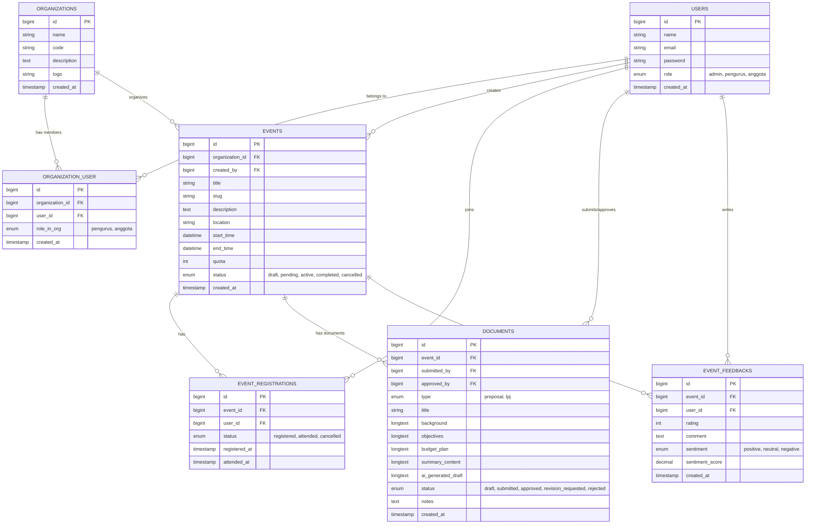
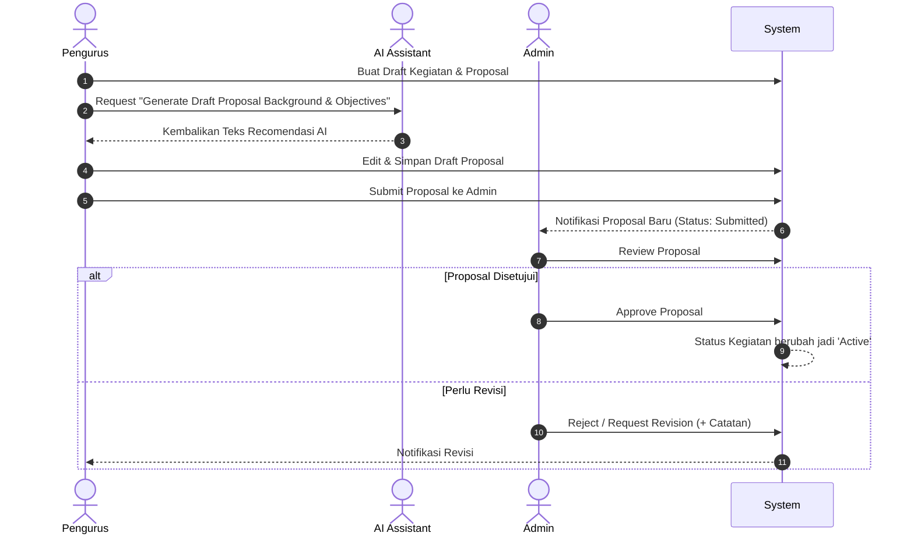
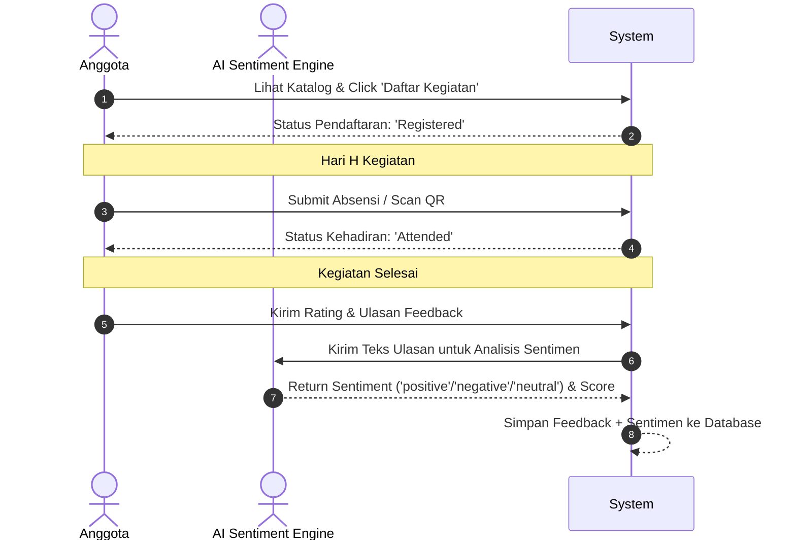

# Technical Blueprint: Campus Organization Management System

Dokumen ini berisi rancangan arsitektur teknis dan cetak biru (blueprint) sistem untuk pembangunan MVP (Minimum Viable Product) **Campus Organization Management System**.

---

## 1. Ringkasan Domain Utama & Entitas

Sistem terbagi ke dalam 5 domain utama:
1. **User & Access Domain**: Mengatur identitas pengguna, login/register, dan hak akses (Admin, Pengurus, Anggota).
2. **Organization Domain**: Mengatur data organisasi/UKM kampus dan keanggotaan pengguna.
3. **Event Management Domain**: Mengatur siklus kegiatan organisasi, pendaftaran peserta, dan absensi.
4. **Proposal & LPJ Domain**: Mengatur penyusunan dokumen proposal/LPJ, bantuan AI draft generator, status approval, serta export PDF.
5. **Feedback & Sentiment Domain**: Mengatur ulasan/rating peserta, analisis sentimen berbasis AI, dan statistik dashboard.

---

## A. ERD Konseptual (Entity Relationship Diagram)



---

## B. Proposal Skema Database (Database Schema)

### 1. Table: `users`
| Column | Type | Constraints / Attributes | Description |
|---|---|---|---|
| `id` | `BIGINT` | `UNSIGNED`, `AUTO_INCREMENT`, `PRIMARY KEY` | ID utama user |
| `name` | `VARCHAR(255)` | `NOT NULL` | Nama lengkap |
| `email` | `VARCHAR(255)` | `UNIQUE`, `NOT NULL` | Email user / institusi |
| `password` | `VARCHAR(255)` | `NOT NULL` | Hashed password |
| `role` | `ENUM` | `'admin', 'pengurus', 'anggota'`, `DEFAULT 'anggota'` | Role global aplikasi |
| `phone` | `VARCHAR(20)` | `NULLABLE` | Nomor HP/WhatsApp |
| `avatar` | `VARCHAR(255)` | `NULLABLE` | Path foto profil |
| `remember_token` | `VARCHAR(100)` | `NULLABLE` | Token remember me |
| `created_at` | `TIMESTAMP` | `NULLABLE` | Waktu dibuat |
| `updated_at` | `TIMESTAMP` | `NULLABLE` | Waktu diubah |

### 2. Table: `organizations`
| Column | Type | Constraints / Attributes | Description |
|---|---|---|---|
| `id` | `BIGINT` | `UNSIGNED`, `AUTO_INCREMENT`, `PRIMARY KEY` | ID Organisasi/UKM |
| `name` | `VARCHAR(255)` | `NOT NULL` | Nama UKM / Organisasi |
| `code` | `VARCHAR(50)` | `UNIQUE`, `NOT NULL` | Kode singkatan (misal: HMTI, BEM) |
| `description` | `TEXT` | `NULLABLE` | Deskripsi UKM |
| `logo` | `VARCHAR(255)` | `NULLABLE` | Path logo organisasi |
| `created_at` | `TIMESTAMP` | `NULLABLE` | Waktu dibuat |
| `updated_at` | `TIMESTAMP` | `NULLABLE` | Waktu diubah |

### 3. Table: `organization_user`
| Column | Type | Constraints / Attributes | Description |
|---|---|---|---|
| `id` | `BIGINT` | `UNSIGNED`, `AUTO_INCREMENT`, `PRIMARY KEY` | Pivot ID |
| `organization_id` | `BIGINT` | `UNSIGNED`, `FOREIGN KEY -> organizations(id)` | ID Organisasi |
| `user_id` | `BIGINT` | `UNSIGNED`, `FOREIGN KEY -> users(id)` | ID User |
| `role_in_org` | `ENUM` | `'pengurus', 'anggota'`, `DEFAULT 'anggota'` | Peran dalam organisasi tertentu |
| `created_at` | `TIMESTAMP` | `NULLABLE` | Tanggal bergabung |
| `updated_at` | `TIMESTAMP` | `NULLABLE` | Tanggal diubah |

### 4. Table: `events`
| Column | Type | Constraints / Attributes | Description |
|---|---|---|---|
| `id` | `BIGINT` | `UNSIGNED`, `AUTO_INCREMENT`, `PRIMARY KEY` | ID Kegiatan |
| `organization_id` | `BIGINT` | `UNSIGNED`, `FOREIGN KEY -> organizations(id)` | Penyelenggara |
| `created_by` | `BIGINT` | `UNSIGNED`, `FOREIGN KEY -> users(id)` | Pembuat kegiatan |
| `title` | `VARCHAR(255)` | `NOT NULL` | Judul kegiatan |
| `slug` | `VARCHAR(255)` | `UNIQUE`, `NOT NULL` | URL friendly slug |
| `description` | `TEXT` | `NOT NULL` | Deskripsi acara |
| `location` | `VARCHAR(255)` | `NOT NULL` | Lokasi / Link Zoom |
| `start_time` | `DATETIME` | `NOT NULL` | Tanggal & jam mulai |
| `end_time` | `DATETIME` | `NOT NULL` | Tanggal & jam selesai |
| `quota` | `INT` | `UNSIGNED`, `DEFAULT 0` | Kuota peserta (0 = unlimted) |
| `status` | `ENUM` | `'draft', 'pending', 'active', 'completed', 'cancelled'`, `DEFAULT 'draft'` | Status siklus kegiatan |
| `created_at` | `TIMESTAMP` | `NULLABLE` | Waktu dibuat |
| `updated_at` | `TIMESTAMP` | `NULLABLE` | Waktu diubah |

### 5. Table: `event_registrations`
| Column | Type | Constraints / Attributes | Description |
|---|---|---|---|
| `id` | `BIGINT` | `UNSIGNED`, `AUTO_INCREMENT`, `PRIMARY KEY` | ID Pendaftaran |
| `event_id` | `BIGINT` | `UNSIGNED`, `FOREIGN KEY -> events(id)` | ID Kegiatan |
| `user_id` | `BIGINT` | `UNSIGNED`, `FOREIGN KEY -> users(id)` | ID Peserta |
| `status` | `ENUM` | `'registered', 'attended', 'cancelled'`, `DEFAULT 'registered'` | Status kehadiran |
| `registered_at` | `TIMESTAMP` | `NOT NULL` | Tanggal mendaftar |
| `attended_at` | `TIMESTAMP` | `NULLABLE` | Tanggal/jam absensi |
| `created_at` | `TIMESTAMP` | `NULLABLE` | Waktu dibuat |
| `updated_at` | `TIMESTAMP` | `NULLABLE` | Waktu diubah |

### 6. Table: `documents` (Proposal & LPJ)
| Column | Type | Constraints / Attributes | Description |
|---|---|---|---|
| `id` | `BIGINT` | `UNSIGNED`, `AUTO_INCREMENT`, `PRIMARY KEY` | ID Dokumen |
| `event_id` | `BIGINT` | `UNSIGNED`, `FOREIGN KEY -> events(id)` | Kegiatan terkait |
| `type` | `ENUM` | `'proposal', 'lpj'` | Jenis dokumen |
| `title` | `VARCHAR(255)` | `NOT NULL` | Judul proposal/LPJ |
| `background` | `LONGTEXT` | `NULLABLE` | Latar belakang |
| `objectives` | `LONGTEXT` | `NULLABLE` | Tujuan & sasaran |
| `budget_plan` | `LONGTEXT` | `NULLABLE` | Rencana anggaran / realisasi |
| `summary_content` | `LONGTEXT` | `NULLABLE` | Kesimpulan / rincian hasil |
| `ai_generated_draft`| `LONGTEXT` | `NULLABLE` | Hasil rekomendasi AI |
| `status` | `ENUM` | `'draft', 'submitted', 'approved', 'revision_requested', 'rejected'`, `DEFAULT 'draft'` | Status approval |
| `notes` | `TEXT` | `NULLABLE` | Catatan revisi / penolakan dari admin |
| `submitted_by` | `BIGINT` | `UNSIGNED`, `FOREIGN KEY -> users(id)` | Pengaju |
| `approved_by` | `BIGINT` | `UNSIGNED`, `NULLABLE`, `FOREIGN KEY -> users(id)` | Penyetuju (Admin) |
| `created_at` | `TIMESTAMP` | `NULLABLE` | Waktu dibuat |
| `updated_at` | `TIMESTAMP` | `NULLABLE` | Waktu diubah |

### 7. Table: `event_feedbacks`
| Column | Type | Constraints / Attributes | Description |
|---|---|---|---|
| `id` | `BIGINT` | `UNSIGNED`, `AUTO_INCREMENT`, `PRIMARY KEY` | ID Feedback |
| `event_id` | `BIGINT` | `UNSIGNED`, `FOREIGN KEY -> events(id)` | Kegiatan terkait |
| `user_id` | `BIGINT` | `UNSIGNED`, `FOREIGN KEY -> users(id)` | Penulis ulasan |
| `rating` | `TINYINT` | `UNSIGNED`, `CHECK (rating BETWEEN 1 AND 5)` | Rating 1 - 5 bintang |
| `comment` | `TEXT` | `NOT NULL` | Isi ulasan/umpan balik |
| `sentiment` | `ENUM` | `'positive', 'neutral', 'negative'`, `DEFAULT 'neutral'` | Result Analisis Sentimen AI |
| `sentiment_score` | `DECIMAL(4,2)`| `DEFAULT 0.00` | Skor confidence (misal: 0.95) |
| `created_at` | `TIMESTAMP` | `NULLABLE` | Waktu ulasan dikirim |
| `updated_at` | `TIMESTAMP` | `NULLABLE` | Waktu diubah |

---

## C. Role-Permission Matrix

| Fitur / Modul | Guest | Anggota | Pengurus | Admin |
|---|:---:|:---:|:---:|:---:|
| **Auth & Profile** |
| Register / Login / Logout | ✅ | ✅ | ✅ | ✅ |
| Update Profile & Password | ❌ | ✅ | ✅ | ✅ |
| **User & Org Management** |
| Melihat Daftar Organisasi | ✅ | ✅ | ✅ | ✅ |
| Kelola Data User & Role | ❌ | ❌ | ❌ | ✅ |
| Kelola Data Organisasi | ❌ | ❌ | Edit Org Sendiri | ✅ All Org |
| **Manajemen Kegiatan** |
| Melihat Katalog Kegiatan Active | ✅ | ✅ | ✅ | ✅ |
| Buat / Edit / Hapus Kegiatan | ❌ | ❌ | ✅ (Org Sendiri) | ✅ |
| Daftar Kegiatan Sebagai Peserta | ❌ | ✅ | ✅ | ✅ |
| Melakukan Absensi Peserta | ❌ | Self Attendance | Marker Absensi | ✅ |
| **Proposal & LPJ** |
| Buat Draft & Pakai AI Helper | ❌ | ❌ | ✅ | ✅ |
| Ajukan Proposal / LPJ | ❌ | ❌ | ✅ | ✅ |
| Review / Approve / Minta Revisi | ❌ | ❌ | ❌ | ✅ |
| Export Proposal/LPJ ke PDF | ❌ | ❌ | ✅ | ✅ |
| **Feedback & Sentiment** |
| Kirim Feedback Kegiatan | ❌ | ✅ (Hanya jika hadir) | ✅ | ✅ |
| Lihat Ringkasan Sentimen AI | ❌ | ❌ | ✅ (Kegiatan Sendiri) | ✅ All Events |
| **Dashboard** |
| Access Admin Dashboard | ❌ | ❌ | ❌ | ✅ |
| Access Pengurus Dashboard | ❌ | ❌ | ✅ | ❌ |
| Access Anggota Dashboard | ❌ | ✅ | ❌ | ❌ |

---

## D. Application Flow (Alur Kerja Utama)

### 1. Flow Siklus Kegiatan & Proposal (Pengurus -> Admin)


### 2. Flow Keikutsertaan Peserta & Feedback Analisis Sentimen


---

## E. Route Map

### 1. Public / Guest Routes
- `GET /` -> Landing Page / Catalog Kegiatan
- `GET /login` -> Form Login
- `POST /login` -> AuthController@login
- `GET /register` -> Form Registrasi
- `POST /register` -> AuthController@register
- `POST /logout` -> AuthController@logout

### 2. Authenticated Routes (Middleware: `auth`)
- `GET /profile` -> ProfileController@edit
- `PUT /profile` -> ProfileController@update

### 3. Anggota Routes (Middleware: `auth`, `role:anggota,pengurus,admin`)
- `GET /my-events` -> MemberEventController@index (Kegiatan yang diikuti)
- `POST /events/{event:slug}/register` -> MemberEventController@register
- `POST /events/{event:slug}/attend` -> MemberEventController@attend
- `POST /events/{event:slug}/feedback` -> MemberFeedbackController@store

### 4. Pengurus Routes (Middleware: `auth`, `role:pengurus,admin`)
- `GET /org/dashboard` -> PengurusDashboardController@index
- `GET /org/events` -> EventController@index
- `GET /org/events/create` -> EventController@create
- `POST /org/events` -> EventController@store
- `GET /org/events/{event}/edit` -> EventController@edit
- `PUT /org/events/{event}` -> EventController@update
- `DELETE /org/events/{event}` -> EventController@destroy
- `GET /org/events/{event}/attendances` -> AttendanceController@index
- `POST /org/events/{event}/ai-generate` -> DocumentAiController@generate
- `GET /org/events/{event}/proposal` -> DocumentController@showProposal
- `POST /org/events/{event}/proposal` -> DocumentController@storeProposal
- `GET /org/events/{event}/lpj` -> DocumentController@showLpj
- `POST /org/events/{event}/lpj` -> DocumentController@storeLpj
- `GET /org/documents/{document}/export-pdf` -> PdfExportController@export

### 5. Admin Routes (Middleware: `auth`, `role:admin`)
- `GET /admin/dashboard` -> AdminDashboardController@index
- `GET /admin/users` -> AdminUserController@index
- `PUT /admin/users/{user}/role` -> AdminUserController@updateRole
- `GET /admin/organizations` -> AdminOrgController@index
- `POST /admin/organizations` -> AdminOrgController@store
- `GET /admin/proposals` -> AdminProposalController@index
- `POST /admin/proposals/{document}/approve` -> AdminProposalController@approve
- `POST /admin/proposals/{document}/reject` -> AdminProposalController@reject

---

## F. Page / Screen Map

1. **Public Pages**:
   - `auth.login`: Form login bersih dengan Tailwind CSS.
   - `auth.register`: Form pendaftaran anggota baru.
   - `events.catalog`: Halaman eksplorasi kegiatan kampus dengan filter kategori & status.
   - `events.show`: Detail kegiatan, sisa kuota, dan tombol daftar.
2. **Anggota Dashboard & Pages**:
   - `anggota.dashboard`: Ringkasan kegiatan yang diikuti & status kehadiran.
   - `anggota.feedback-form`: Modal / form rating 1-5 bintang & ulasan.
3. **Pengurus Dashboard & Pages**:
   - `pengurus.dashboard`: Quick stats (Total kegiatan, Peserta, Status Proposal/LPJ, Grafik Sentimen).
   - `pengurus.events.index`: Tabel manajemen kegiatan UKM.
   - `pengurus.documents.editor`: Editor proposal/LPJ interaktif dengan tombol **"Bantu dengan AI"**.
   - `pengurus.attendances.index`: Daftar hadir peserta per kegiatan.
4. **Admin Pages**:
   - `admin.dashboard`: Global metrics aplikasi.
   - `admin.users.index`: Tabel user & perizinan role.
   - `admin.proposals.index`: Antrean review proposal/LPJ masuk.

---

## G. Service & Module Architecture

Untuk menjaga kode tetap ramah maintainability tanpa overengineering, arsitektur dibagi menjadi modul standar Laravel + Service Classes:

```
app/
├── Http/
│   ├── Controllers/
│   │   ├── Auth/
│   │   ├── Admin/
│   │   ├── Pengurus/
│   │   └── Member/
│   ├── Middleware/
│   │   └── CheckRole.php
│   └── Requests/
│       ├── StoreEventRequest.php
│       ├── StoreDocumentRequest.php
│       └── StoreFeedbackRequest.php
├── Models/
│   ├── User.php
│   ├── Organization.php
│   ├── Event.php
│   ├── EventRegistration.php
│   ├── Document.php
│   └── EventFeedback.php
├── Policies/
│   ├── EventPolicy.php
│   └── DocumentPolicy.php
└── Services/
    ├── AiService.php           # Mengurus integrasi LLM (Drafting & Prompting)
    ├── SentimentService.php    # Mengurus klasifikasi sentimen ulasan
    └── PdfService.php          # Mengurus rendering DomPDF untuk proposal/LPJ
```

---

## H. AI Integration Architecture

### 1. Boundary & Responsibilities
- **Provider & Adapter**: Laravel `Http::withToken(...)` terhubung ke LLM API (Groq / OpenAI / Gemini REST API).
- **Isolasi Key**: API Key wajib diatur pada `.env` (`LLM_API_KEY`, `LLM_API_URL`, `LLM_MODEL`) dan dipanggil via `config/services.php`.
- **Tidak ada Hardcode Prompt**: Prompt template diletakkan di file konfigurasi/service terpisah.

### 2. Payload Format & Structuring

#### A. Proposal Drafting Request:
```json
{
  "model": "gemini-2.5-flash",
  "messages": [
    {
      "role": "system",
      "content": "Anda adalah asisten administrasi organisasi mahasiswa yang profesional. Buatlah draf latar belakang dan tujuan proposal dalam Bahasa Indonesia yang formal dan persuasif."
    },
    {
      "role": "user",
      "content": "Judul Kegiatan: Workshop Web Dev. Organisasi: HMTI. Target: 100 Mahasiswa. Tujuan Utama: Mengenalkan Laravel dan Vibe Coding."
    }
  ]
}
```

#### B. Sentiment Analysis Request:
```json
{
  "model": "gemini-2.5-flash",
  "messages": [
    {
      "role": "system",
      "content": "Analisis ulasan berikut. Kembalikan HANYA format JSON valid: {\"sentiment\": \"positive\"|\"neutral\"|\"negative\", \"confidence\": 0.0-1.0}"
    },
    {
      "role": "user",
      "content": "Acara sangat seru dan pematerinya jelas banget! Tapi pendingin ruangan sedikit panas."
    }
  ]
}
```

### 3. Fallback & Error Handling Strategy
- **Timeout & Retry**: Set `Http::timeout(10)->retry(2, 500)`.
- **Graceful Fallback**: Jika API offline atau kuota habis, sistem memberikan pesan fallback yang dapat diedit manual oleh user tanpa merusak flow pengajuan dokumen.

---

## I. Testing Strategy

1. **Automated Feature Tests**:
   - `AuthenticationTest`: Memastikan login, register, dan proteksi middleware role berjalan.
   - `EventManagementTest`: Memastikan Pengurus dapat membuat kegiatan dan Anggota dapat mendaftar.
   - `ProposalWorkflowTest`: Memastikan pengurus dapat membuat proposal & admin dapat approve/reject.
   - `FeedbackSentimentTest`: Memastikan ulasan tersimpan dan analisis sentimen terikat pada feedback kegiatan.
2. **Service Unit Tests**:
   - `SentimentServiceTest`: Menguji penanganan respon JSON dari AI dengan mock HTTP client (`Http::fake()`).
   - `PdfExportTest`: Memastikan DomPDF memuat data proposal tanpa error render.

---

## J. Blueprint Review & Self-Audit Report

Sebelum menyelesaikan tahap ini, dilakukan review terhadap blueprint di atas:

1. **Conflict Check**:
   - *Requirement*: Pengurus mengelola kegiatan, Admin menyetujui proposal.
   - *Audit*: Alur status kegiatan `draft` -> `pending` -> `active` konsisten dengan peranan admin dan pengurus.
2. **Redundancy Check**:
   - *Audit*: Penggabungan tabel `proposal` dan `lpj` ke dalam satu tabel `documents` dengan atribut `type` menghilangkan duplikasi skema data.
3. **Authorization & Security Check**:
   - *Audit*: Seluruh modul telah dipetakan dalam *Role-Permission Matrix* dan dilindungi middleware `role:x`.
4. **Overengineering Check**:
   - *Audit*: Menghindari penggunaan Spatie Permission / OAuth multi-layer yang kompleks. Cukup `role` enum pada tabel `users` dan `organization_user` pivot table yang sederhana dan efisien.

---
*Status Blueprint: Approved & Verified for MVP Implementation.*
